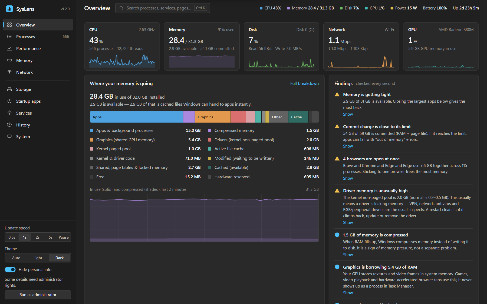
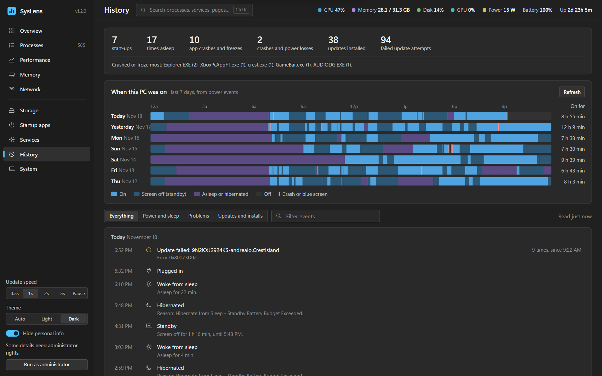
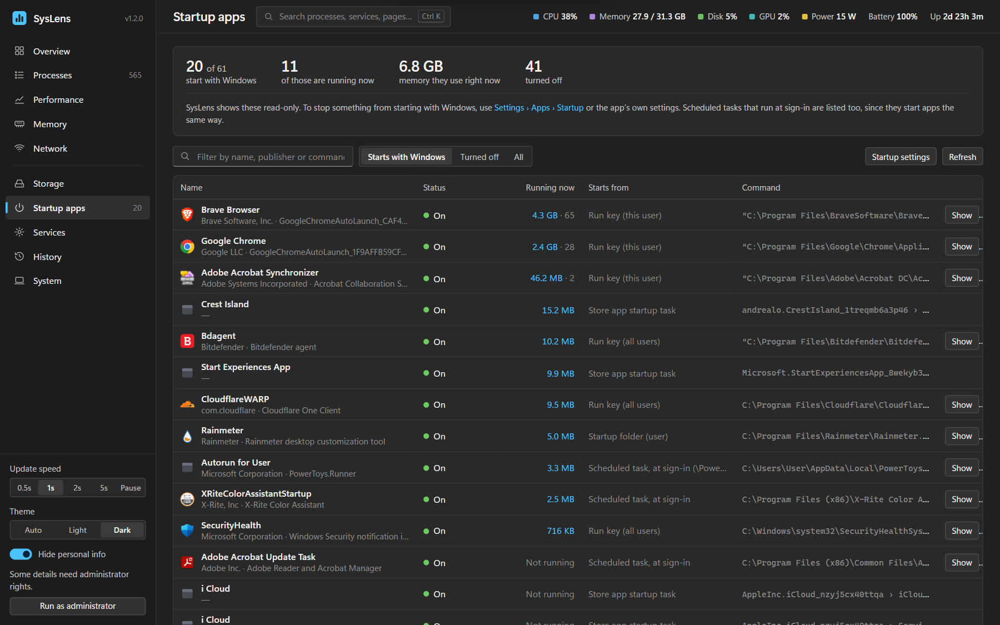
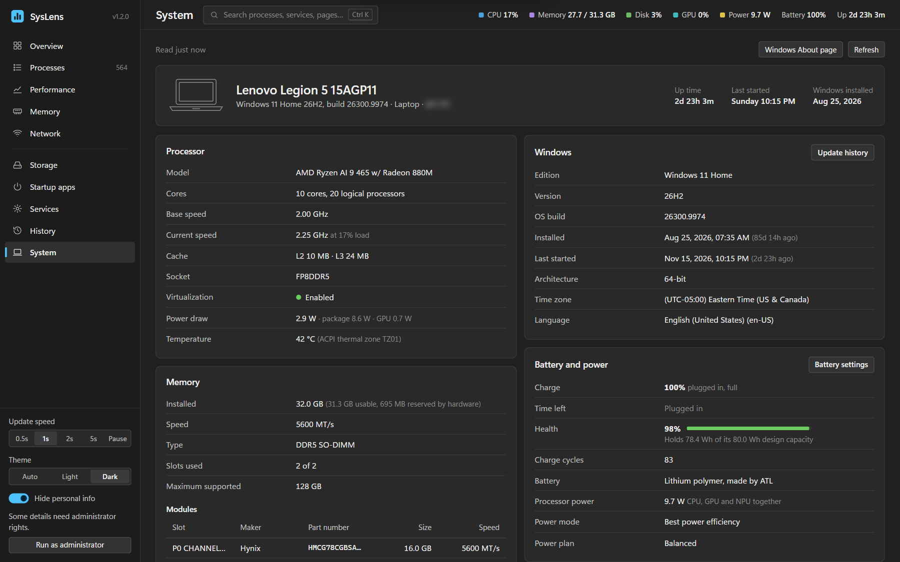
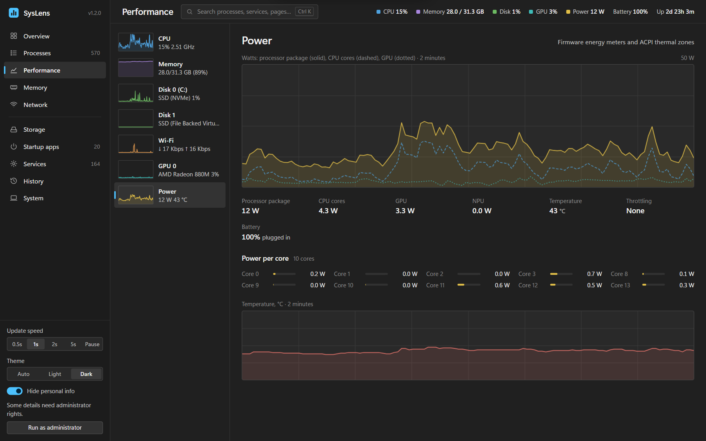
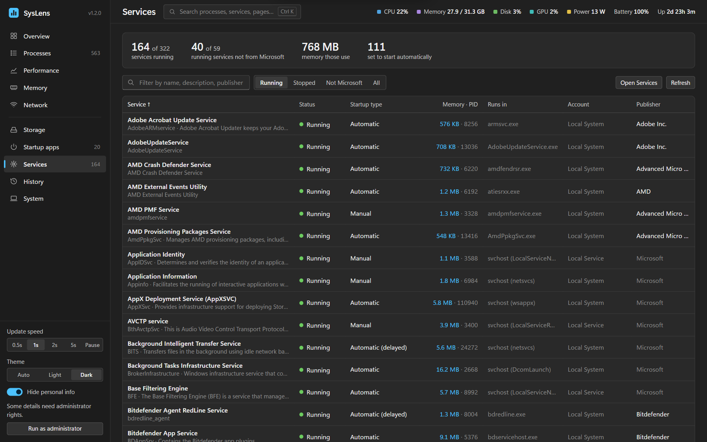
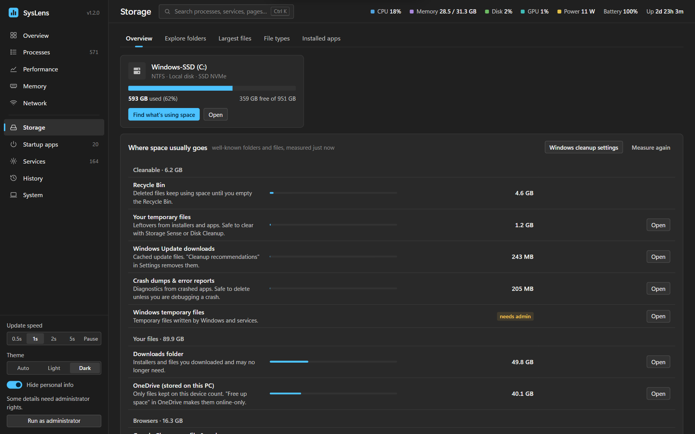
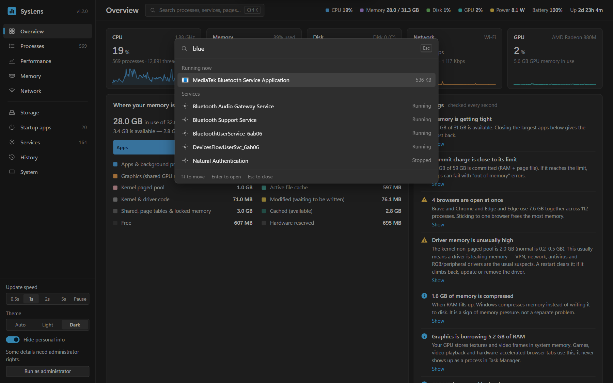

<div align="center">


# SysLens

**The better Task Manager for Windows.**

Every process, where your RAM really goes, what fills your disk, what starts with Windows,
and what your PC did while you were away. In plain language, on one screen.


[Install](#install) · [What it shows](#what-it-shows) · [Screenshots](#screenshots) · [Shortcuts](#keyboard-shortcuts) · [FAQ](#faq) · [How it works](#how-it-works)



</div>

## Why SysLens

Task Manager says your memory is 88% used, but its process list adds up to about half of that. SysLens accounts for every byte, explains each part in a sentence, and tells you which parts you can do something about.

It does the same for everything else it shows: which app is talking to which server, what starts with Windows and what it costs right now, what woke your PC at 3 a.m., and whether your battery is wearing out.

| You want to know | Where to look |
|---|---|
| Why is my RAM full? | **Memory**: all installed RAM, split into apps, compressed memory, graphics, drivers, cache and hardware-reserved memory |
| What is slowing my PC down right now? | **Overview** findings, then **Processes** sorted by CPU, memory or disk |
| Which app is using the internet, and talking to whom? | **Network**: every connection with its app and the server's host name |
| What is listening on port 3000? | **Network** › Listening ports |
| What starts with Windows, and what does it cost? | **Startup apps**: on or off, and how much memory each is using now |
| Did my PC crash, sleep or update last night? | **History**: a week of start-ups, sleep, crashes, blue screens and updates |
| How worn out is my battery? | **System** › Battery and power |
| Are Secure Boot, BitLocker and memory integrity on? | **System** › Security |
| What is filling my disk? | **Storage**: a full-drive scan, the largest files, apps by real size |
| How much power is the processor drawing, and how hot is it? | **Performance** › Power |

## What it shows

### Overview
- Live CPU, memory, disk, network and GPU, with power draw, battery and up time in the title bar
- Where your memory is going, with every category explained
- Findings, checked every second: memory pressure, the commit limit getting close, several browsers open at once, a leaking driver, an app leaking handles, dev servers left running
- The apps using the most memory and CPU, and recent activity from the event logs

### Processes
- Grouped by app, with helper processes inside their app. WebView2 helpers count toward the app that started them.
- Three views: by app, all processes, and a tree of who started what
- Browser and Electron processes labeled by role (tab, extension, GPU process…), and each svchost by the service it runs
- CPU, memory (the private working set, the same number Task Manager shows), GPU, GPU memory, disk and I/O, handles and threads, with Task Manager-style shading
- A details panel: what the process is, live CPU and memory graphs, its user account and integrity level, 32- or 64-bit, command line, parent chain, child processes, open windows, the services inside it and its network connections
- **End task**, with a confirmation that says how much memory you'll get back. Critical Windows processes are protected.

### Performance
- CPU (total and every logical processor), memory, each disk, each network adapter and every GPU engine
- **Power**: processor package, CPU cores, GPU and NPU in watts, power per core, temperature and thermal throttling, on PCs whose firmware reports them

### Memory
- All installed RAM in one bar, and a table explaining each part and what to do about it
- Memory over time, commit charge against its limit, page file use and hard faults
- Apps ranked by private memory, working set or commit

### Network
- The connection you're on: Wi-Fi name, signal, band and standard, IP address, gateway and DNS
- Throughput over the last two minutes, and every adapter with its addresses and driver
- Every TCP and UDP connection with the app that owns it and the remote server's host name. Connections inside your own PC are hidden unless you ask for them.
- Which app is listening on which port

### Storage
- Drives, and the usual space hogs: Recycle Bin, temporary files, Downloads, update caches, browser data, developer caches, WSL and Docker disks, game libraries
- A read-only full-drive scan with a clickable treemap, the largest files, a breakdown by file type, and installed apps by their measured size

### Startup apps
- Everything that starts with Windows: Run keys, Startup folders, Store apps and scheduled tasks that run at sign-in
- Whether each one is on or off, who made it, and how much memory it is using right now

### Services
- Every Windows service with its state, startup type, the process hosting it and that process's memory, the account it runs as, and its publisher
- A **Not Microsoft** filter, so third-party services are easy to spot

### History
- A seven-day chart of when the PC was on, in standby, asleep or off, with crashes marked
- Start-ups, shutdowns and who asked for each restart; sleep and wake, with what woke the PC; app crashes and freezes; blue screens; crashed services; Windows updates and installs. Repeats fold into one line.

### System
- Device, firmware and BIOS; Windows edition and build, install date and last start
- Processor with caches and live speed, memory modules, graphics driver, display, disks and their health
- Battery health (the charge it can still hold against its design capacity), charge cycles, power mode and plan
- Security at a glance: antivirus, firewall, Secure Boot, TPM, BitLocker, memory integrity, Smart App Control and UAC
- Recent updates, and how much memory SysLens itself is using

### Everywhere
- **Ctrl+K** searches pages, running apps, services, startup entries and actions
- Light and dark themes that follow Windows, and your Windows accent color when it's a color
- **Hide personal info** replaces your user and PC names and blurs network names and hardware IDs, for screenshots you want to share
- Reconnects by itself after sleep, and restarts its own server if it ever crashes

SysLens never deletes anything. Storage shows where the space went and opens the folder for you. Ending a process is the only change it makes, and it asks first.

## Screenshots

<table>
  <tr>
    <td width="50%"><br><sub><b>Processes.</b> Grouped by app, with a details panel for whatever you select.</sub></td>
    <td width="50%"><br><sub><b>Memory.</b> Every byte of RAM accounted for and explained.</sub></td>
  </tr>
  <tr>
    <td><br><sub><b>Network.</b> Wi-Fi, adapters, listening ports and connections per app.</sub></td>
    <td><br><sub><b>History.</b> When the PC was on, asleep or off this week, and what happened.</sub></td>
  </tr>
  <tr>
    <td><br><sub><b>Startup apps.</b> What starts with Windows and what it costs you right now.</sub></td>
    <td><br><sub><b>System.</b> Hardware, Windows, battery health and security in one place.</sub></td>
  </tr>
  <tr>
    <td><br><sub><b>Performance › Power.</b> Watts per component and per core, and temperature.</sub></td>
    <td><br><sub><b>Performance › CPU.</b> Every logical processor, Task Manager style.</sub></td>
  </tr>
  <tr>
    <td><br><sub><b>Services.</b> Who made each service and what it costs.</sub></td>
    <td><br><sub><b>Storage.</b> Drives and the places space usually goes.</sub></td>
  </tr>
  <tr>
    <td><br><sub><b>Ctrl+K.</b> One search for apps, services, startup entries, pages and actions.</sub></td>
    <td><br><sub><b>Light theme.</b> Follows Windows, or pick one.</sub></td>
  </tr>
</table>

<sub>Taken on a Lenovo Legion 5 laptop with <b>Hide personal info</b> turned on.</sub>

## Install

**You need**
- Windows 10 or 11 (64-bit)
- [Node.js](https://nodejs.org) 20 or newer
- Microsoft Edge (built into Windows) or Google Chrome, which SysLens uses as its window

**Get it**

```bash
git clone https://github.com/seoedw/syslens-the-better-task-manager.git SysLens
cd SysLens
npm install
npm run shortcut
```

`npm run shortcut` adds SysLens to your desktop and Start menu, so you can open it like any other app. Clone it somewhere permanent first (Documents is fine), because the shortcuts point into that folder.

<details>
<summary>Other ways to start it</summary>

- Double-click `SysLens.cmd` in the folder. It installs the dependencies the first time.
- From a terminal: `npm start`.
- For development: `npm run dev` runs the server without a window and prints its address.

</details>

<details>
<summary>Update or uninstall</summary>

**Update:** run `git pull` in the folder, then reopen SysLens.

**Uninstall:** delete the folder, the two SysLens shortcuts (desktop and Start menu), and `%LOCALAPPDATA%\SysLens`, which holds the window's browser profile and the log.

</details>

**Run as administrator.** Without admin rights, Windows hides a few things: the full paths and command lines of some system processes, and a few protected folders. Click **Run as administrator** in the sidebar and the same window reconnects with full access.

## Keyboard shortcuts

| Keys | What it does |
|---|---|
| `Ctrl` + `K` | Search everything |
| `Ctrl` + `1` … `Ctrl` + `0` | Go to Overview, Processes, Performance, Memory, Network, Storage, Startup apps, Services, History, System |
| `Ctrl` + `F` or `/` | Search the process list |
| `↑` `↓` | Move through processes |
| `Enter`, `←` `→` | Expand or collapse an app |
| `Del` | End the selected task (asks first) |
| `Esc` | Clear the search, or close the details panel |

## FAQ

### Why doesn't Task Manager add up?
Task Manager's process list counts each app's private memory. The rest of "in use" belongs to no process: compressed pages, RAM borrowed by the graphics chip, memory used by drivers, the file cache, and memory the firmware reserves before Windows starts. SysLens measures each of those and shows them side by side, so the parts add up to the total.

### Does SysLens change anything on my PC?
No. Everything is read-only apart from **End task**, which asks first and won't touch critical Windows processes. Startup apps and services are shown, not edited: their buttons open the matching page in Windows Settings.

### Does it send data anywhere?
No. The server listens on `127.0.0.1` only, and nothing leaves your PC. The one network lookup it makes is resolving the host names of servers your apps connect to, through the DNS server you already use.

### How much memory does SysLens use?
About 220 MB on the laptop in the screenshots, most of it the window. **System › About SysLens** shows the live number. The window is a Microsoft Edge app window started without GPU acceleration, extensions or background services, which saves roughly 230 MB compared with a normal Edge window.

### Why Node.js and an Edge window instead of a normal .exe?
Windows' Smart App Control blocks unsigned programs, and a self-built desktop app is unsigned. Node.js and Edge are signed, so SysLens runs on PCs with Smart App Control turned on, with nothing to install but Node.js.

### Why are power or temperature missing on my PC?
Power comes from energy meters that some processors expose to Windows (common on recent AMD and Intel laptops). Temperature comes from the ACPI thermal zone. If your PC doesn't report them, SysLens leaves those parts out instead of guessing.

### The window says "Connection lost"
It reconnects by itself after 1, 2 and 3 seconds, then every 5 seconds, even while minimized. **Retry now** tries straight away. A small launcher restarts the server if it ever crashes, on the same address, so the window carries on where it was. What happened is written to `%LOCALAPPDATA%\SysLens\syslens.log` (**System › About SysLens › Show log**).

## How it works

SysLens reads the same sources Task Manager, Process Explorer and Resource Monitor use, mostly by calling Windows directly through [koffi](https://koffi.dev), with no native build step:

| Data | Source |
|---|---|
| Processes, private memory, CPU time, I/O, handles, threads | `NtQuerySystemInformation(SystemProcessInformation)`: one call for every process |
| Paths, command lines, versions, icons, user, integrity, architecture | `QueryFullProcessImageName`, `NtQueryInformationProcess`, `GetFileVersionInfo`, `PrivateExtractIcons`, process tokens, `IsWow64Process2` |
| Memory lists, kernel pools, file cache, commit | Performance counters (PDH): `\Memory\*` |
| GPU use and GPU memory per process and adapter | PDH: `\GPU Engine(*)`, `\GPU Process Memory(*)`, `\GPU Adapter Memory(*)` |
| CPU, disks, network | PDH: `\Processor Information(*)`, `\PhysicalDisk(*)`, `\Network Interface(*)` |
| Power, temperature, battery | PDH: `\Energy Meter(*)`, `\Thermal Zone Information(*)`; `GetSystemPowerStatus`; the battery report |
| Connections per app | `GetExtendedTcpTable` and `GetExtendedUdpTable` (the source TCPView uses); host names by reverse DNS |
| Folder sizes | `FindFirstFileExW` with large fetch, on a pool of worker threads |
| Startup apps, services, adapters, hardware, security | The registry, Task Scheduler and CIM, read through PowerShell when their page opens |
| History | The System and Application event logs |

The backend is plain Node.js. A small launcher starts the server and restarts it if it crashes or stops responding. The server serves the UI on `127.0.0.1`, opens it in an Edge (or Chrome) `--app` window with its own profile, and keeps running only while that window is open.

**Security**
- Listens on `127.0.0.1` only. Every request needs a random per-run token, which the window receives in the URL fragment, so it never crosses the network.
- Rejects requests whose `Host` isn't the local address (DNS rebinding) and anything that isn't JSON (cross-site form posts). Sends no CORS headers.
- Checks that a PID still belongs to the same process before ending it.
- An administrator instance never writes its token to disk.

<details>
<summary>Project layout</summary>

```
src/main/            backend (Node.js)
  launcher.js          starts the server and restarts it if it crashes or hangs
  server.js            HTTP server, live event stream, window and lifecycle
  monitor.js           sampling loop, history, memory accounting, power and temperature
  processes.js         process table, grouping, details, end task
  network.js           connections per app, host names, adapters and Wi-Fi
  startup.js           everything that starts with Windows
  services.js          Windows services
  history.js           the week's events and the on/sleep/off timeline
  machine.js           hardware, Windows, battery and security for the System page
  pdh.js, win32.js     performance counters and Windows API bindings
  insights.js          findings
  knowledge.js         "What is this?" explanations
  storage/             drives, parallel folder scanner, apps, space hogs
src/renderer/        UI (plain HTML, CSS and JavaScript, no build step)
scripts/             self-test, icon, shortcuts
docs/screenshots/    the images in this README
```

`npm run selftest` prints what the collectors see, without the UI.

</details>

## Known limits

- Per-process network *speed* needs kernel tracing (ETW) and isn't shown. Connections per app are.
- Folders inside `C:\Windows\WinSxS` use hard links, so a folder scan counts some files more than once.
- Part of a drive's used space is invisible to any folder scan: restore points, shadow copies and NTFS metadata. SysLens shows how much.
- Per-process GPU memory includes surfaces shared with other apps, so those rows can add up to more than the total.
- CPU temperature on most desktops needs a kernel driver, which SysLens doesn't install.

## Thanks

SysLens builds on ideas from Windows Task Manager, Sysinternals Process Explorer, TCPView and RAMMap, and WizTree. It calls Windows through [koffi](https://koffi.dev) by Niels Martignène. This README takes its shape from [Stats](https://github.com/exelban/stats), [btop](https://github.com/aristocratos/btop), [bottom](https://github.com/ClementTsang/bottom), [NeoHtop](https://github.com/Abdenasser/neohtop) and [PowerToys](https://github.com/microsoft/PowerToys).
